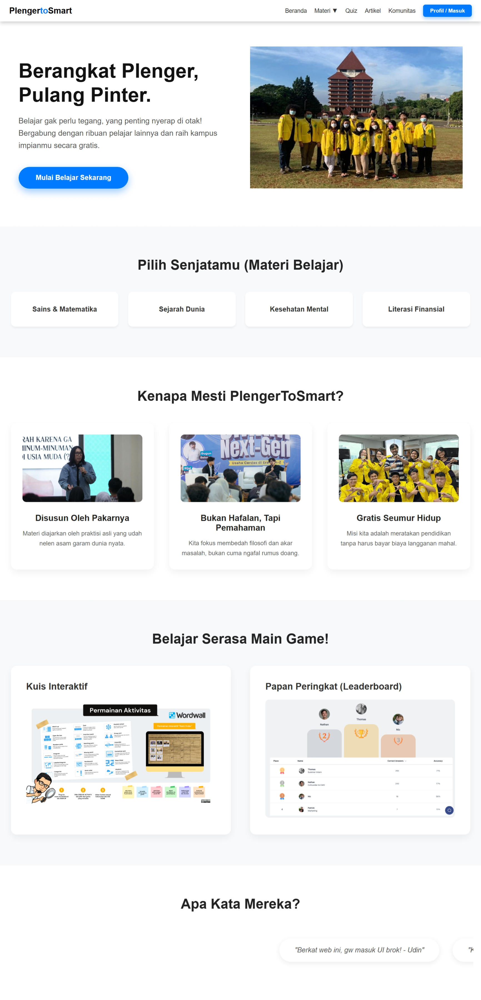
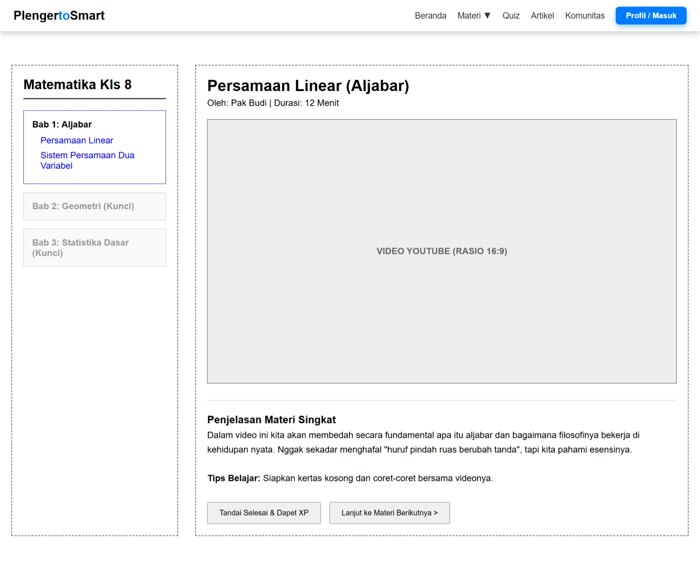
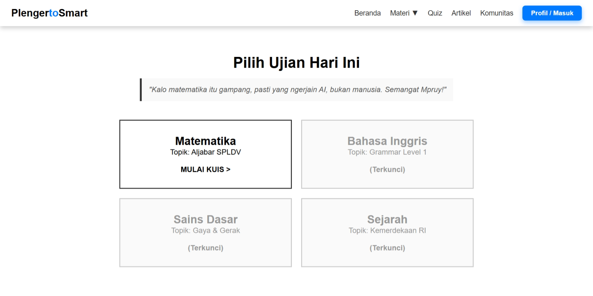
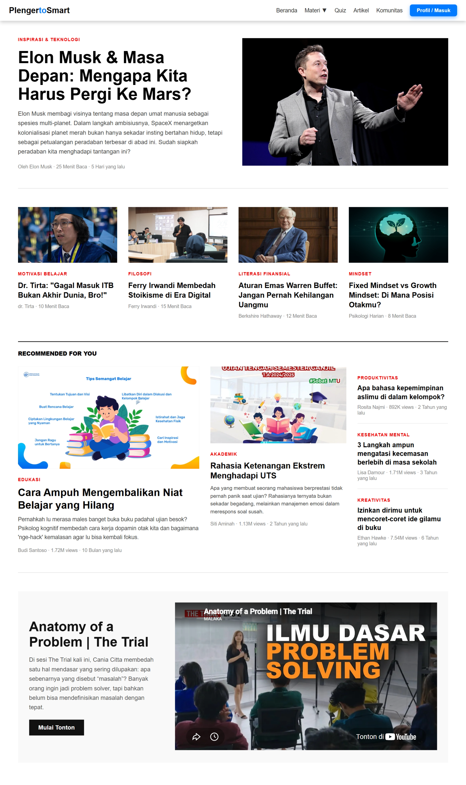
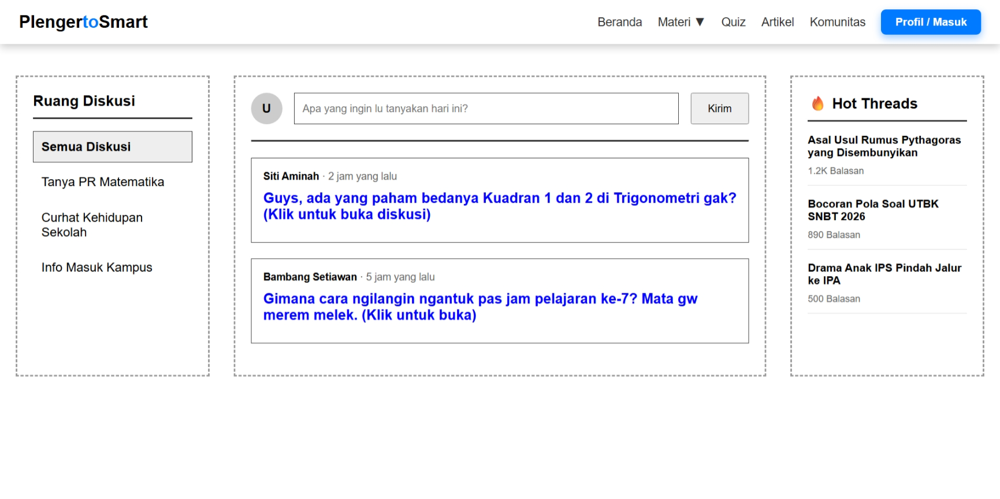
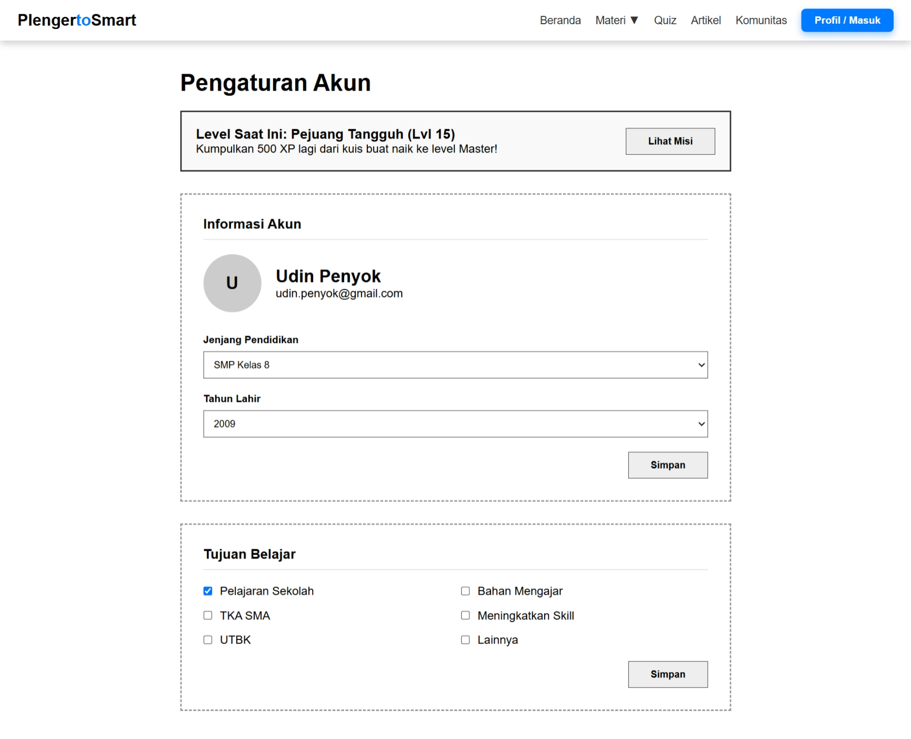

# 🎓 PlengerToSmart

> **Berangkat Plenger, Pulang Pinter.**
> Platform edukasi gratis buat pelajar Indonesia: belajar materi, latihan kuis, baca artikel, dan diskusi bareng di komunitas. Belajar gak perlu tegang, yang penting nyerap di otak!


## 🔗 Demo

👉 **[Buka Website Demo](https://webwmart.gt.tc/)**

---

## 📑 Daftar Isi

- [Tentang Proyek](#-tentang-proyek)
- [Fitur](#-fitur)
- [Tampilan](#-tampilan)
- [Teknologi](#-teknologi)
- [Struktur Folder](#-struktur-folder)
- [Penjelasan Halaman](#-penjelasan-halaman)
- [Cara Menjalankan](#-cara-menjalankan)
- [Cara Kerja Kuis](#-cara-kerja-kuis)
- [Catatan Versi MVP](#-catatan-versi-mvp)

---

## 📖 Tentang Proyek

**PlengerToSmart** adalah website edukasi berbasis PHP yang dibuat sebagai MVP (*Minimum Viable Product*). Targetnya pelajar yang pengen belajar tanpa tegang. Saat ini konten yang aktif adalah **Matematika SMP Kelas 8 (Aljabar / SPLDV)**, sedangkan mata pelajaran dan jenjang lain masih terkunci.

---

## ✨ Fitur

| Fitur | Deskripsi |
|-------|-----------|
| 🏠 **Beranda** | Landing page dengan hero section, kategori materi, keunggulan platform, gamifikasi, dan testimoni berjalan. |
| 📚 **Materi** | Sidebar daftar bab + konten utama (video & penjelasan). Bab yang belum tersedia ditandai terkunci. |
| 📝 **Kuis** | Lobi pilih ujian, halaman soal dengan timer animasi 10 menit, dan penilaian otomatis. |
| 🏆 **Papan Peringkat** | Skor kamu dibandingkan dengan bot-bot lucu (Albert Einsten, Siti Jenius, dll). |
| 📰 **Artikel** | Artikel utama, grid artikel, section *Brain Break* (video YouTube), dan rekomendasi bacaan. |
| 💬 **Komunitas** | Forum 3 kolom: topik diskusi, feed postingan, dan *Hot Threads*. |
| 👤 **Profil** | Pengaturan akun, level & XP, jenjang pendidikan, dan tujuan belajar. |
| 🧭 **Mega Menu** | Dropdown *Materi* bertingkat: Mata Pelajaran → Tingkat → Kelas. |

---

## 🖼 Tampilan

### Beranda


### Materi


### Lobi Kuis


### Artikel


### Komunitas


### Profil

---

## 🛠 Teknologi

- **Backend:** PHP native (tanpa framework)
- **Frontend:** HTML5 + CSS3 murni (Flexbox, CSS Grid, media query, animasi CSS)
- **Font:** Poppins
- **Database:** MySQL via `mysqli` (disiapkan, belum dipakai di versi MVP)
- **Hosting demo:** InfinityFree

Tidak ada JavaScript, build tool, atau dependensi eksternal. Timer kuis dan efek hover dibuat 100% pakai CSS.

---

## 📁 Struktur Folder

```
Project_website_edukasi/
│
├── index.php            # Beranda (landing page)
├── materi.php           # Halaman materi (Matematika SMP Kelas 8)
├── quiz_awal.php        # Lobi kuis (pilih mata pelajaran)
├── quiz.php             # Halaman soal kuis + timer
├── quiz_hasil.php       # Penilaian, koreksi jawaban, papan peringkat
├── artikel.php          # Halaman artikel
├── komunitas.php        # Forum komunitas
├── profil.php           # Profil & pengaturan akun
├── navbar.php           # Komponen navbar (di-include ke semua halaman)
├── database.php         # Koneksi database MySQL
│
├── screenshots/         # Gambar tampilan untuk README
│
└── assets/
    ├── css/
    │   ├── style_navbar.css   # Gaya global + navbar + mega menu (dipakai semua halaman)
    │   ├── beranda.css
    │   ├── materi.css
    │   ├── quiz.css
    │   ├── artikel1.css
    │   ├── artikel2.css
    │   ├── komunitas.css
    │   └── profil.css
    │
    └── img/                   # Gambar (foto, ilustrasi, preview fitur)
```

---

## 📄 Penjelasan Halaman

| File | Fungsi |
|------|--------|
| `index.php` | Beranda: hero, kategori materi, value proposition, gamifikasi, testimoni. |
| `materi.php` | Sidebar bab (Bab 1 Aljabar terbuka; Geometri & Statistika terkunci) dan area video + deskripsi. |
| `quiz_awal.php` | Lobi kuis. Saat ini baru Matematika (Aljabar SPLDV) yang aktif. |
| `quiz.php` | 6 soal pilihan ganda, form `POST` ke `quiz_hasil.php`, timer visual 10 menit. |
| `quiz_hasil.php` | Menghitung skor, quotes sesuai nilai, koreksi soal salah, dan leaderboard. |
| `artikel.php` | Artikel utama, 4 artikel grid, Brain Break (YouTube embed), dan rekomendasi. |
| `komunitas.php` | Topik diskusi, feed postingan, komentar, dan hot threads. |
| `profil.php` | Info akun, level/XP, jenjang pendidikan, tahun lahir, tujuan belajar. |
| `navbar.php` | Navbar + mega menu, di-include lewat `<?php include "navbar.php"; ?>`. |
| `database.php` | Membuka koneksi `mysqli` ke database. |

---

## 🚀 Cara Menjalankan

> Website ini memakai PHP (`include "navbar.php"`), jadi **tidak bisa** dijalankan dengan cara klik dua kali file `.php`. Harus lewat server PHP.

### Opsi 1: Lihat langsung online
Buka **[webwmart.gt.tc](https://webwmart.gt.tc/)**, tidak perlu install apa pun.

### Opsi 2: Jalankan di komputer sendiri

**1. Download proyek**
- Klik tombol hijau **Code → Download ZIP** di halaman repository ini, atau ambil file `.zip` dari menu **Releases** kalau tersedia.
- Ekstrak file ZIP-nya.

**2. Jalankan lewat salah satu cara berikut**

**Pakai XAMPP / Laragon:**
1. Salin folder hasil ekstrak ke `htdocs/` (XAMPP) atau `www/` (Laragon).
2. Nyalakan **Apache**.
3. Buka `http://localhost/<nama-folder>/index.php` di browser.

**Pakai server bawaan PHP** (kalau PHP sudah terpasang):
```bash
cd <nama-folder-hasil-ekstrak>
php -S localhost:8000
```
Lalu buka `http://localhost:8000/index.php`.

### Opsi 3: Upload ke hosting
Upload semua isi folder ke `htdocs/` hosting (File Manager atau FTP), pastikan folder `assets/` ikut ter-upload.

---

## 🧮 Cara Kerja Kuis

1. **`quiz_awal.php`** menampilkan pilihan mata pelajaran.
2. **`quiz.php`** menampilkan 6 soal pilihan ganda (Aljabar SPLDV). Semua soal wajib dijawab, jawaban dikirim dengan metode `POST`.
3. **`quiz_hasil.php`** mencocokkan jawaban dengan kunci jawaban (array PHP), lalu:
   - menghitung skor (100 dibagi 6 soal, dibulatkan),
   - menampilkan quotes berbeda sesuai nilai,
   - menampilkan koreksi soal yang salah beserta pembahasan,
   - menyusun papan peringkat dengan bot memakai `usort()`.

Kalau halaman hasil dibuka langsung tanpa mengerjakan kuis, pengguna diarahkan kembali ke lobi kuis.

---

## ⚠️ Catatan Versi MVP

Versi ini masih **MVP**, jadi:

- Halaman belum terhubung ke database. File `database.php` sudah disiapkan, tapi **belum dipakai** oleh halaman mana pun, sehingga website bisa jalan tanpa MySQL.
- Data profil (Udin Penyok), level/XP, postingan komunitas, dan papan peringkat masih **data contoh (statis)**.
- Skor kuis **belum tersimpan**, dan timer 10 menit baru berupa animasi visual (belum auto-submit).
- Tombol **Profil / Masuk** mengarah ke halaman profil contoh, belum ada sistem login sungguhan.
- Hanya Matematika SMP Kelas 8 yang aktif; konten lain berstatus terkunci.

---

## 👨‍💻 Pembuat

**Muhammad Raditya Duta Pratama** — Kelas X PPLG 1

---

<p align="center">
  <b>PlengerToSmart</b>: Belajar gak perlu tegang, yang penting nyerap di otak! 🧠
</p>
